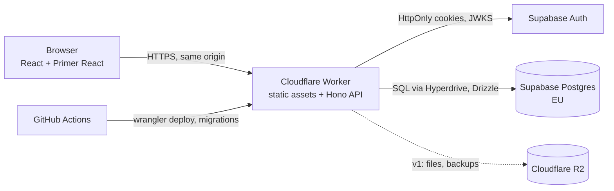

# Prompt Hub

Store, version and reuse AI prompts. Projects hold prompts, every prompt has a version history, `{{variables}}` are filled in at use time, and one click copies the finished prompt to the clipboard. Built first for ComfyUI image/video work and LLM prompts; designed from day one as a multi-user, internet-facing service with security as a requirement.

> **Status:** Phase 0 (Discovery) is finishing; Phase 1 (Foundation) is next. No application code yet. Working name — "PromptHub" is taken by another product, a new name is chosen before any public launch ([#7](https://github.com/olexiy/prompt-hub/issues/7)).

## What it does (planned)
- **Projects → folders → prompts → versions.** A new version is one click; old versions stay in the history (visible to the author only) and can be compared with a diff or deleted.
- **Variables.** `{{hair_color}}`, `{{duration | select:6s,9s,15s}}` — a form fills them in, **Copy** puts the rendered prompt on the clipboard.
- **Public or private projects**, like GitHub repositories, with GitHub-like URLs: `/{user}/{project}/{folder}/{prompt}`.
- **Tags, search, meta fields, import/export** (single prompts, whole projects as zip).
- **ComfyUI workbench (v1):** attach result images/videos to a version; *Comfy Extractor* pulls the prompt and the full workflow description out of a ComfyUI PNG or video.
- **Later:** comments and stars on public projects, AI tools (translate, optimise, analyse token cost, storyboard from a rough idea), Free/Pro plans.

Full numbered catalogue and version plan: [docs/FEATURES.md](docs/FEATURES.md).

## Roadmap
| Phase | Milestone | Goal |
|---|---|---|
| 0 | [Discovery](https://github.com/olexiy/prompt-hub/milestone/1) | market scan, features, architecture, roadmap |
| 1 | [Foundation](https://github.com/olexiy/prompt-hub/milestone/2) | monorepo, CI/CD with security scans, environments, single-user sign-in, app shell, first vertical slice |
| 2 | [MVP](https://github.com/olexiy/prompt-hub/milestone/3) | my prompts online, safely: versions, variables, copy, tags, search, import/export |
| 3 | [v1 ComfyUI workbench](https://github.com/olexiy/prompt-hub/milestone/4) | result files, Comfy Extractor, sections, templates |
| 4 | [v2 Public and friends](https://github.com/olexiy/prompt-hub/milestone/5) | comments, stars, forks, profiles, moderation, 2FA |
| 5 | [v3 AI and Pro](https://github.com/olexiy/prompt-hub/milestone/6) | plans and limits, AI translate/optimise/analyse, model templates |
| 6 | [v4 AI studio](https://github.com/olexiy/prompt-hub/milestone/7) | AI screenwriter, variants, prompt from image, semantic search |

## Architecture
TypeScript end to end on Cloudflare Workers and Supabase, €0/month.

| | |
|---|---|
| Frontend | React 19, Primer React (GitHub's design system), Vite, en/ru/de |
| Backend | Hono on Cloudflare Workers — one deployable serving UI and `/api` |
| Data and auth | Supabase Postgres + Auth (EU), Drizzle ORM, Cloudflare Hyperdrive |
| Repo (planned) | pnpm monorepo: `apps/web`, `apps/api`, `packages/core`, `packages/db`, `e2e` |

Why this stack and the alternatives considered: [docs/research/architecture.md](docs/research/architecture.md) · decisions: [docs/decisions.md](docs/decisions.md).

## Security
Security is a requirement, not a later phase. Target: **OWASP ASVS 5.0 Level 2**. Invite-only sign-up, HttpOnly cookie sessions, server-side authorisation on every request, strict CSP, rate limits, supply-chain hardening (release-age gate for npm packages, blocked install scripts, SHA-pinned actions), CodeQL, secret scanning with push protection, Dependabot and daily vulnerability scans. Found a vulnerability? See [SECURITY.md](SECURITY.md).

## Development
Commands are added with the Phase 1 skeleton ([#17](https://github.com/olexiy/prompt-hub/issues/17)).

Every change follows a visible process: an issue per task, a branch per issue, a PR with green CI, squash merge, the issue closed with what was verified. Playbook: [docs/DEV_PROCESS.md](docs/DEV_PROCESS.md).

| Document | Purpose |
|---|---|
| [docs/PROJECT_PLAN.md](docs/PROJECT_PLAN.md) | goals, architecture, phases and exit criteria (authoritative) |
| [docs/FEATURES.md](docs/FEATURES.md) | numbered feature catalogue and versions |
| [docs/decisions.md](docs/decisions.md) | decision log (ADRs) |
| [docs/research/](docs/research/) | market scan, architecture options |
| [docs/findings-log.md](docs/findings-log.md) | observations and things that did not work |
| [docs/brief.md](docs/brief.md) | the original idea |

## Licence
Not chosen yet — all rights reserved until a licence is added.
