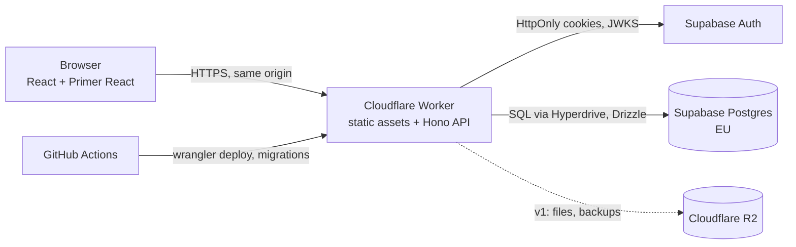

# Prompt Hub — project plan

> Store, version and reuse AI prompts: projects → prompts → versions, variables, comments, meta fields, public/private sharing, import, one-click copy.

Related: [brief.md](brief.md) · [DEV_PROCESS.md](DEV_PROCESS.md) · [decisions.md](decisions.md) · [findings-log.md](findings-log.md)

## Open questions

1. ~~**Hosting budget**~~ — **€0/month** for now; a sleeping DB is acceptable (2026-10-23).
2. ~~**Build, fork or adopt**~~ — **build** (2026-10-23, see [research/market-scan.md](research/market-scan.md)).
3. **Name** — "PromptHub" is taken (prompthub.us, same niche); rename before anything public. Candidates: Promptyard, Promptloft, Prompt Atelier (domains and trademarks not checked yet).

## 1. Goals and non-goals

**Goals**

- One place for all of Olexiy's prompts (image/video generation, LLM, coding), with history, so a good prompt never gets lost or overwritten.
- Prompts as templates: variables, filled in at use time, one-click copy of the rendered result.
- Multi-user, internet-facing from day one: accounts, private and public projects, a security posture fit for a public service.
- A portfolio-quality codebase and a GitHub-visible process.

- Designed as a potential paid product: Free/Pro plans and limits live in the data model from the start, billing is built late (v3+).

**Non-goals (for now)**

- Running prompts against models, evaluation, tracing or observability (LLMOps platforms do this).
- Integrations (REST API, MCP, CLI, ComfyUI node, browser extension): copy & paste is the integration.
- Teams/organisations billing; real payments until the product is actually launched.

## v1 scope and versions

Full list and reasoning: [FEATURES.md](FEATURES.md). Product shape: project → optional folders → prompts → versions (button-created, history visible only to the author, deletes are final); variables with one-click rendered copy; public projects show latest versions only; invite-only registration.

| Version | Theme                      | Highlights                                                                                                                                 |
| ------- | -------------------------- | ------------------------------------------------------------------------------------------------------------------------------------------ |
| MVP     | My prompts, online, safely | projects, folders, versions + diff, variables + copy, tags + search, private/public, zip import/export, invites, EN/RU/DE, themes, backups |
| v1      | ComfyUI workbench          | result images/videos, Comfy Extractor, sections, task templates, labels, typed variables, value sets                                       |
| v2      | Public and friends         | visitor comments, stars, forks, profiles, public search, reports, admin, 2FA, OAuth                                                        |
| v3      | AI and Pro                 | plans and limits, BYOK / OpenRouter, translate, optimiser and analyst, model templates, legal pages                                        |
| v4      | AI studio                  | AI screenwriter, variants, prompt from image, custom system prompts, semantic search, payments                                             |

## 2. Architecture

Decided 2026-10-23 (#4). Details and alternatives: [research/architecture.md](research/architecture.md); ADRs in [decisions.md](decisions.md).

| Area     | Decision                                                                                                                                         |
| -------- | ------------------------------------------------------------------------------------------------------------------------------------------------ |
| Language | TypeScript end to end                                                                                                                            |
| Frontend | React 19 + Primer React (GitHub's design system), Vite, i18n en/ru/de                                                                            |
| Backend  | Hono on Cloudflare Workers, modular monolith, one deployable serving UI and `/api`                                                               |
| Data     | Supabase Postgres (EU), Drizzle ORM + SQL migrations, via Cloudflare Hyperdrive                                                                  |
| Auth     | Supabase Auth, invites only, session in HttpOnly cookies, JWT verified via JWKS                                                                  |
| Files    | Cloudflare R2 (from v1)                                                                                                                          |
| Repo     | pnpm monorepo: `apps/web`, `apps/api`, `packages/core`, `packages/db`, `e2e`                                                                     |
| CI/CD    | GitHub Actions: PR checks (lint, types, tests, e2e, security scans), preview deploys to staging, production by manual dispatch after Olexiy's go |
| Security | OWASP ASVS 5.0 Level 2; supply-chain hardening (release-age gate, no install scripts, SHA-pinned actions); daily vulnerability scans             |
| Cost     | €0/month (Cloudflare Free, Supabase Free ×2: prod + staging)                                                                                     |

## 3. Phases

Each phase = a GitHub milestone + epic issue (`phase-N`). Tasks are created when the phase starts.

### Phase 0 — Discovery

**Goal:** decide whether, what, how and in which order to build.
**Tasks:** market scan (build vs. adopt) · feature catalogue and v1 scope · architecture and stack · roadmap on GitHub.
**Exit criteria:**

- [x] Market scan done; Olexiy decided build / fork / adopt. → **build**
- [x] Feature catalogue with priorities; v1 scope agreed with Olexiy. → [FEATURES.md](FEATURES.md)
- [x] Architecture, stack, hosting and security standard decided and recorded as ADRs.
- [x] Development phases exist as milestones + epics; Phase 1 split into tasks.

### Phase 1 — Foundation · epic [#10](https://github.com/olexiy/prompt-hub/issues/10)

**Goal:** a secure, deployable skeleton with one thin vertical slice in production.
**Tasks (in order):** #16 mockups → #17 monorepo skeleton → #18 CI with security scans → #19 test harness → #20 DB schema v0 → #21 environments and deploys (needs Olexiy's Cloudflare + Supabase accounts) → #22 single-user sign-in (sign-up closed; invites come in Phase 2) → #23 security baseline → #24 app shell → #25 vertical slice.
**Exit criteria:** commands documented; CI green and required on `main`; preview and production deploys work; sign-in on production with sign-up closed; vertical slice project → prompt → variables → copy in production; authorisation tests; mockups approved.

### Phase 2 — MVP · epic [#11](https://github.com/olexiy/prompt-hub/issues/11)

**Goal:** "my prompts, online, safely" — Olexiy uses it daily instead of text files.
**Exit criteria:** all MVP features in production with tests; comfy-h3-studio and vault prompts imported; backup restore tested; `/security-review` before release; a week of daily use.

### Phase 3 — v1 ComfyUI workbench · epic [#12](https://github.com/olexiy/prompt-hub/issues/12)

**Goal:** the best place for ComfyUI image/video prompts (result files, Comfy Extractor, sections, templates).

### Phase 4 — v2 Public and friends · epic [#13](https://github.com/olexiy/prompt-hub/issues/13)

**Goal:** friends use it; public projects with comments, stars, forks, moderation, 2FA.

### Phase 5 — v3 AI and Pro · epic [#14](https://github.com/olexiy/prompt-hub/issues/14)

**Goal:** plans and limits enforced, first AI tools, legal pages, final product name (#7).

### Phase 6 — v4 AI studio · epic [#15](https://github.com/olexiy/prompt-hub/issues/15)

**Goal:** AI-assisted authoring (screenwriter, variants, prompt from image), semantic search.

Tasks for phases 2–6 are created when the phase starts; each epic lists its feature IDs from [FEATURES.md](FEATURES.md). Stopping after any phase is acceptable.

## 4. Risks

| Risk                                                       | Mitigation                                                                                     |
| ---------------------------------------------------------- | ---------------------------------------------------------------------------------------------- |
| A mature product already covers the need                   | Market scan first; stopping after Phase 0 is an acceptable outcome                             |
| Scope creep from "many more features"                      | Explicit v1 scope with won't-have list                                                         |
| Hosting costs or free-tier traps (DB pausing, cold starts) | Budget ceiling decided up front; check free-tier limits online                                 |
| Security of a public multi-user service                    | Security standard chosen in Phase 0, checks in the DoD, `/security-review` before going public |

## 5. Status

| Phase          | State                                                      |
| -------------- | ---------------------------------------------------------- |
| 0 — Discovery  | done — build, features and versions, architecture, roadmap |
| 1 — Foundation | next                                                       |
| 2–6            | planned                                                    |
