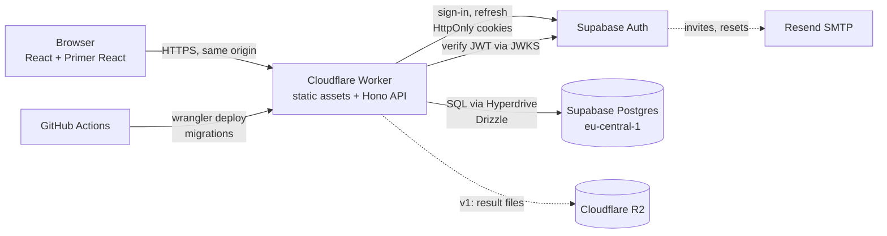

# Architecture — stack, hosting, repo, CI/CD, security, design

Issue #4 · checked online on **2026-10-23**. Constraints from Olexiy: **€0 per month**; a sleeping DB is fine; his stack is *not* required ("Claude writes the code: pick what is best, safest and most convenient"); **security is a top priority** (AI-assisted attacks, latest versions, monitoring for zero-days); design simple and functional, GitHub-like; the existing Hetzner server (personal sites) only if it brings a big advantage. Scope: [FEATURES.md](../FEATURES.md).

## TL;DR — recommendation (revision 2)
**TypeScript end to end on Cloudflare Workers:** one Worker serves the React + Primer React app and a Hono REST API; **Postgres and Auth on Supabase Free** reached through Cloudflare Hyperdrive; shared validation and prompt-rendering code in one package; files later on R2. **€0/month, two vendors (Cloudflare, Supabase), no servers to patch, no cold starts, EU data.**

Revision 1 recommended Spring Boot on Cloud Run + Angular. It still works and stays the alternative (§2), but on a strict €0 budget it costs more complexity for no security gain: a JVM needs GraalVM native images to avoid 5–15 s cold starts, a third vendor (Google, with a card) and two dependency ecosystems (Maven and npm), while the frontend needs npm anyway.

## 1. Current versions (npm registry / spring.io, today)
| Item | Version | Item | Version |
|---|---|---|---|
| TypeScript | 7.0.2 | React | 19.3.1 |
| Hono | 4.13.13 | @primer/react | 38.42.0 (React 18/19) |
| Vite | 8.3.5 | @primer/css | 22.3.2 |
| Wrangler | 4.152.0 | Drizzle ORM | 0.45.4 |
| Zod | 4.6.7 | @supabase/supabase-js | 2.118.0 |
| Vitest | 5.0.5 | Playwright | 1.64.1 |
| pnpm | 12.15.0 | Node (local) | 24 |
| *Alternative:* Spring Boot | 4.1.2 | *Alternative:* Angular | 22.2.3 |

## 2. Stack options

| | **A. TS on Cloudflare Workers** *(recommended)* | B. Spring Boot + Angular (revision 1) | C. Supabase only (Edge Functions + RLS) |
|---|---|---|---|
| Runtime | V8 isolates, patched by Cloudflare; no OS, no container | JVM native image in a container on Cloud Run | Deno Edge Functions |
| Cold start | none (isolates start in ms) | seconds on JVM, sub-second only with native image | yes, function cold starts |
| Free hosting | Workers Free: 100k requests/day | Cloud Run free tier, card required | Supabase Free: 500k invocations |
| Vendors | Cloudflare + Supabase | Google + Supabase + Cloudflare | Supabase (+ static host) |
| Languages / supply chains | one (TS, npm) | two (Java/Maven + TS/npm) | one, but logic split between SQL policies and functions |
| Shared code front/back | yes: one Zod schema validates in the form and in the API; one renderer for `{{variables}}` in preview and export | duplicated (Java + TS) | partial |
| Security model | authorisation in one API layer, integration tests per endpoint | same, Spring Security | Row Level Security for everything: powerful, easy to get subtly wrong |
| GitHub look | **Primer React = GitHub's real components** (accessible, light/dark) | Primer CSS only, own components | same as A or B |
| Olexiy reads it easily | good (TS); React less familiar than Angular | best | medium |

**Why A wins now:** smallest attack surface we have to maintain (no server, no container image, no JVM), zero cold starts on a free plan, one language and one dependency tree to harden, and the real GitHub component library. The npm supply chain is the main risk of A; §6 hardens it explicitly.

**Why not Supabase Edge Functions alone:** business logic would live half in RLS policies and half in Deno functions; harder to test and review than one API. We still use Supabase for what it does best: Postgres and Auth.

## 3. Hosting and services

| Need | Choice | Free tier (today) | Trap → mitigation |
|---|---|---|---|
| App + API | **Cloudflare Workers** (static assets + Hono) | 100k requests/day, 10 ms CPU per request | CPU limit → keep handlers lean; heavy work (AI, extractors) later in queues or Workers Paid ($5) if ever needed |
| DB | **Supabase Free** Postgres, `eu-central-1` | 500 MB, 2 projects (prod + staging) | pauses after 7 days idle (accepted); own nightly `pg_dump` backup |
| DB connection | **Cloudflare Hyperdrive** | included on Workers Free (~100k queries/day, ~20 origin connections) | daily quota → fine for friends-scale; monitor |
| Auth | **Supabase Auth** | 50k MAU, email/password, OAuth, TOTP MFA | sign-up closed, invites only (103); session in **HttpOnly cookies set by our Worker**, not in `localStorage` |
| Mail | Supabase built-in, later **Resend** | 3,000/month, 100/day | built-in SMTP is rate-limited → Resend when friends join |
| Files (v1) | **Cloudflare R2** | 10 GB, zero egress | card on file; per-upload and per-plan limits |
| Bot protection | **Cloudflare Turnstile** + free managed WAF rules | free | on sign-in and invite acceptance |

**Rejected:** Render (sleeps after 15 min, ~1 min wake-up), Fly.io (no free tier), Koyeb (card-free plan removed), Oracle Always Free (halved in June 2026, idle VMs reclaimed), Cloudflare Containers ($5), **Hetzner** — see §8.

## 4. Components


One deployable, same origin for UI and API (no CORS, simple cookie security). Not microservices: at this scale they add attack surface and ops without benefit; the code is a **modular monolith** split by feature modules.

## 5. Monorepo layout (pnpm workspaces)
```
apps/web/          React 19 + Primer React, Vite build, i18n (en/ru/de)
apps/api/          Hono Worker: REST API under /api, serves apps/web build as static assets
packages/core/     Zod schemas, types, {{variable}} parser and renderer, slug rules (used by web and api)
packages/db/       Drizzle schema, SQL migrations, seed data
e2e/               Playwright specs
docs/              plan, decisions, research, runbooks
.github/workflows/ ci.yml, deploy.yml, security.yml
```

## 6. CI/CD and supply-chain security
**CI (`ci.yml`)** — on `pull_request` and `workflow_dispatch` only (DEV_PROCESS §4), `dorny/paths-filter` skips test jobs for docs-only PRs:
1. `pnpm install --frozen-lockfile` (cached)
2. lint (ESLint) · format check (Prettier) · typecheck (`tsc`)
3. unit + integration tests (Vitest; API tests in the Workers runtime via `@cloudflare/vitest-pool-workers`, DB tests against a Postgres service container)
4. build
5. e2e (Playwright against local Worker + Postgres), report uploaded only on failure
6. security: gitleaks (secrets), `pnpm audit --prod`, OSV-Scanner on the lockfile, Semgrep CE (SAST)

**CD (`deploy.yml`)**
- Every PR: preview version of the Worker (`wrangler versions upload`) against the **staging** Supabase project; URL posted to the PR.
- Production: `workflow_dispatch` only, run after Olexiy's explicit go (project rule: deploys need approval) → DB migrations → `wrangler deploy` → smoke test.

**Scheduled (`security.yml`)** — daily OSV-Scanner + `pnpm audit` on `main`; opens an issue labelled `security` on findings.

**Supply-chain hardening (npm is the main risk: Shai-Hulud worm waves 2025–2026 hit ~800 packages; a May 2026 wave abused `pull_request_target` in GitHub Actions):**
- pnpm with **`minimumReleaseAge`** (new versions only after ~3 days; security fixes allowed explicitly), install scripts blocked unless allow-listed, lockfile required.
- **Dependabot**: alerts and security updates (free for private repos) immediately; version updates weekly, grouped, with a cooldown. "Latest versions" means latest *stable after the cooldown*.
- GitHub Actions: pinned to commit SHAs, `permissions: read-all` by default, **never `pull_request_target`**, secrets only in the deploy job, Cloudflare API token scoped to this Worker only.
- Few dependencies by policy: every new runtime dependency is named in the PR and justified.
- Paid GitHub features we skip on a private repo (CodeQL code scanning, push protection) are replaced by Semgrep CE and gitleaks (pre-commit + CI). If the repo goes public, CodeQL and push protection become free and are switched on.

**Zero-day monitoring:** Dependabot alerts + daily OSV scan for our code; Cloudflare patches the Workers runtime, Supabase patches Postgres and Auth (no OS or container of ours to patch); Cloudflare free managed WAF rules in front; `/security-review` before every production deploy that touches auth, authorisation or input handling.

## 7. Application security standard
**OWASP ASVS 5.0, Level 2.** Concrete controls from the MVP:
- **AuthN** by Supabase Auth (we store no passwords); public sign-up off, invites only; Turnstile on sign-in; TOTP MFA in v2. Session: access/refresh tokens in `HttpOnly; Secure; SameSite=Lax` cookies set by the Worker; JWTs (ES256) verified against Supabase JWKS on every API call.
- **AuthZ** in one API layer: every query is scoped by owner or by `PUBLIC` visibility; public reads return only latest versions; an integration test per endpoint proves "other user → 404".
- **Input**: Zod on every request body and query; size limits (prompt body, tags, slugs); slugs from a whitelist pattern; prompt text rendered as text, never HTML.
- **Headers**: strict CSP (no inline scripts), HSTS, `X-Content-Type-Options`, `Referrer-Policy`, `frame-ancestors 'none'`.
- **Rate limiting**: Workers rate-limiting binding per user and IP on writes, invites and auth endpoints.
- **Secrets**: Wrangler secrets and GitHub Actions secrets only; Supabase service key never reaches the browser; Supabase Data API (PostgREST) disabled — the Worker is the only data path.
- **Backups**: nightly `pg_dump` to R2, restore tested once per version.
- **Privacy**: EU regions; account deletion and export in v1.

## 8. Hetzner and the cloud question
- **Hetzner server (personal sites): not used.** It would mean patching an OS and Docker ourselves, a single box that also hosts other people's sites (bigger blast radius in both directions), and the only gain — an always-on process — is not needed with Workers.
- **Google Cloud vs AWS** (relevant only for option B): Cloud Run runs any container, scales to zero and has a permanent free tier (2M requests/month). AWS's nearest equivalent, App Runner, has no free tier; Lambda has an always-free 1M requests but Java on Lambda needs SnapStart or adapters plus API Gateway, and new AWS accounts since July 2025 get a credit-based free plan for six months. With option A, **no hyperscaler is needed at all**.

## 9. Data model sketch (MVP, ready for later versions)
- `app_user` (id = Supabase user id, `handle` unique, display name, locale, theme, `plan` FREE/PRO, created_at)
- `project` (id, owner_id, `slug` unique per owner, name, description, visibility PRIVATE/PUBLIC, archived_at, timestamps)
- `folder` (id, project_id, parent_id null, slug, name)
- `prompt` (id, project_id, folder_id null, `slug` unique per project+folder, title, type TEXT/CHAT/MEDIA, `current_version_id`, meta JSONB, timestamps)
- `prompt_version` (id, prompt_id, `number`, body, sections JSONB null (v1), variables JSONB (name, type, default, description), message, created_at; deleting removes the row)
- `tag`, `project_tag`, `prompt_tag` (tag per owner)
- `invite` (code hash, created_by, email, expires_at, used_by)
- `plan_limit` (plan, max_projects = 25, max_prompts = 250, …) — data from MVP, enforced from v3
- Later without reshaping: `comment`, `star`, `attachment`, `report`, `ai_budget`
- IDs UUIDv7; URLs `handle/project/folder/prompt`; full-text search via Postgres `tsvector` (`simple` config for EN/RU/DE).

## 10. Design language
Simple and functional, for IT people, GitHub-like: **Primer React** components, Primer tokens, Octicons, light/dark from Primer themes. Screens follow GitHub patterns: header with search; `handle / project` page with tabs; folders and prompts as a file list; prompt page as a file view (monospace body, **Copy** top right, variables panel beside it); *History* as a commit list with diffs; labels as Primer labels, tags as topics. References: GitHub; [Quotient PromptLab UI by Evil Martians](https://evilmartians.com/chronicles/ui-for-quotient-ai-the-developer-tool-for-prompt-engineers) (variables next to the prompt); Langfuse prompt views (versions + labels). A clickable mockup of the main screens is the first UI task of the build.

## 11. Cost
| Item | Monthly |
|---|---|
| Cloudflare Workers Free, Hyperdrive, R2 10 GB, Turnstile | €0 |
| Supabase Free (prod + staging) | €0 |
| Resend (3,000 mails) | €0 |
| Domain | optional, ~€10–15/year, only when going public |
| **Total** | **€0** |

**Accounts Olexiy creates himself:** Cloudflare (card needed for R2 only, at v1), Supabase; Resend later. No Google Cloud.

## Decision
**2026-10-23: revision 2 accepted** — ADRs in [decisions.md](../decisions.md), summary in [PROJECT_PLAN.md](../PROJECT_PLAN.md). Olexiy also allowed making the repo public; then CodeQL and push protection are switched on for free (§6).
