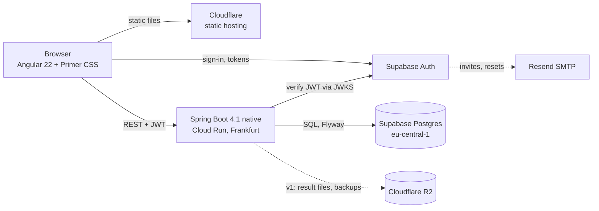

# Architecture options — stack, hosting, data, security, design

Issue #4 · checked online on **2026-10-23**. Constraints from Olexiy: **€0 per month** for now; a sleeping DB is fine (the project is worked on regularly); Supabase optional; design should feel like GitHub — simple, for IT people. Scope: [FEATURES.md](../FEATURES.md) (MVP first, plans/limits in the data model from day one).

## TL;DR — recommendation
**Spring Boot 4.1 (Java 25) + Angular 22 + Primer CSS, Postgres and Auth on Supabase Free, API on Google Cloud Run (free tier, GraalVM native image), frontend on Cloudflare (free static hosting), files later on Cloudflare R2.** Total: **€0/month**, EU regions, Olexiy's home ground, no self-written password handling.

## 1. Current versions (checked today)
| Item | Version | Source |
|---|---|---|
| Spring Boot | **4.1.2** (current GA), 4.0.9, 3.5.16 | [api.spring.io](https://api.spring.io/projects/spring-boot/releases) |
| Angular | **22.2.3**, needs Node `^22.22.3 \|\| ^24.15.0 \|\| >=26` | [npm](https://registry.npmjs.org/@angular/core/latest) |
| Java | 25 LTS (21 installed locally; 25 to be installed) | — |
| Primer CSS | MIT, 13k ★, pushed today | [primer/css](https://github.com/primer/css) |
| Primer React | MIT, 3.9k ★, pushed today | [primer/react](https://github.com/primer/react) |
| Spartan UI (shadcn for Angular) | 1.x stable, 55+ components | [spartan-ng](https://github.com/spartan-ng/spartan) |

## 2. Stack options

| | A. Spring Boot + Angular *(recommended)* | B. TypeScript on Cloudflare | C. Angular + Supabase only |
|---|---|---|---|
| Backend | Spring Boot 4.1, Java 25, REST, Spring Security resource server | Hono on Cloudflare Workers | none: Supabase Data API + Row Level Security, Edge Functions for extras |
| Frontend | Angular 22 + Primer CSS | React + Primer React (real GitHub components) | Angular 22 + Primer CSS |
| DB | Postgres (Supabase or Neon) | Cloudflare D1 (SQLite) | Supabase Postgres |
| Cost | €0 | €0 | €0 |
| Cold start | yes on Cloud Run; native image cuts it from seconds to sub-second (blog claims, we measure in Phase 1) | none | none |
| Fit with Olexiy | home ground, portfolio for Java consulting | new stack, learning curve | little backend code to show |
| Security model | authorisation in one backend, testable with integration tests | same, in TS | everything in RLS policies — powerful but easy to get subtly wrong, hard to test |
| Later AI features (OpenRouter, budgets) | natural in a backend | fine | Edge Functions (Deno), weaker |

**Why A:** the product is mostly CRUD + versioning + authorisation; Spring Boot is where Olexiy is fastest and where the security story is strongest (method security, integration tests against real Postgres with Testcontainers). B is the cheapest to run but throws away the home-ground advantage; C is fastest to start but puts the whole security model into RLS.

## 3. Hosting, DB, auth, files — free tiers and traps

| Need | Choice | Free tier (today) | Trap and mitigation |
|---|---|---|---|
| API | **Google Cloud Run**, `europe-west3` (Frankfurt) | 2M requests, 180k vCPU-s, 360k GiB-s per month ([pricing](https://cloud.google.com/run/pricing)) | needs a billing account (card) though €0; JVM cold start 5–15 s → **GraalVM native image** (Spring Boot supports it), set a budget alert at €1 |
| DB | **Supabase Free** Postgres, `eu-central-1` | 500 MB DB, 2 projects, 5 GB egress | pauses after 7 days idle (accepted); daily backups on Free are limited → our own `pg_dump` job to R2/GitHub (feature 72) |
| Auth | **Supabase Auth** (same project) | 50k MAU; email/password, magic links, OAuth, TOTP MFA | disable public sign-up and use admin invites (103); verify asymmetric JWTs (ES256) in Spring via the JWKS URL; built-in email is rate-limited → custom SMTP via **Resend** free (3,000/month, 100/day) when friends join |
| Frontend | **Cloudflare** Workers static assets / Pages | free, global CDN, custom domain later | none relevant |
| Files (v1: result images/videos) | **Cloudflare R2** | 10 GB, zero egress | needs a card on file; size limits per upload and per plan |

Rejected for the API: **Render** free (spins down after 15 min, ~1 min wake-up, 750 h cap — [docs](https://render.com/docs/free)); **Fly.io** (no free tier, ~$3.19/mo for 512 MB); **Koyeb** (card-free plan removed Feb 2026, per a third-party source); **Oracle Always Free** (allowance halved to 2 OCPU / 12 GB in June 2026, idle VMs reclaimed, capacity errors in Frankfurt — [InfoQ](https://infoq.com/news/2026/07/oracle-cloud-free-tier-limits/)); **Hetzner** (not free, ~€5.49/mo, and we'd own patching); **Cloudflare Containers** (needs Workers Paid $5/mo).
Alternative DB: **Neon Free** (0.5 GB, 100 CU-hours, scales to zero after 5 min, cold start ~1 s) — fine, but then auth is ours or a third vendor; Supabase gives Postgres + Auth in one free project.

**Supabase hardening:** the backend is the only data path. Turn off the Data API (PostgREST) or expose no tables to it, never ship the service key to the browser, the browser only talks to Supabase Auth.

## 4. Components

## 5. Data model sketch (MVP, ready for later versions)
- `app_user` (id = Supabase user id, `handle` unique, display name, locale, theme, `plan` = FREE/PRO, created_at)
- `project` (id, owner_id, `slug` unique per owner, name, description, visibility PRIVATE/PUBLIC, archived_at, timestamps)
- `folder` (id, project_id, parent_id null, slug, name) — optional nesting
- `prompt` (id, project_id, folder_id null, `slug` unique per project+folder, title, type TEXT/CHAT/MEDIA, `current_version_id`, meta JSONB, timestamps)
- `prompt_version` (id, prompt_id, `number`, body text, sections JSONB null (v1), message, created_at; deleted = row removed)
- `variable` (id, prompt_version_id, name, type, default_value, description) — or JSONB on the version; decided in Phase 1
- `tag`, `project_tag`, `prompt_tag` (tag text per owner)
- `invite` (code hash, created_by, email, expires_at, used_by)
- `plan_limit` (plan, max_projects=25, max_prompts=250, …) — enforced from v3, data present from MVP
- Later without reshaping: `comment`, `star`, `attachment`, `report`, `ai_budget`
- IDs: UUIDv7; URLs use `handle/project-slug/folder-slug/prompt-slug`, renames keep IDs stable.
- Full-text search: Postgres `tsvector` with the `simple` config (works for EN/RU/DE without stemming bias), upgraded later if needed.

## 6. Security standard
**OWASP ASVS 5.0, Level 2** (the level OWASP recommends for apps handling user data). Concrete MVP controls:
- **AuthN** by Supabase Auth (no passwords stored by us), sign-up closed, invites only; TOTP MFA available from v2.
- **AuthZ** on every request in the service layer: owner checks for private data, public read only for `PUBLIC` projects and only latest versions; an integration test per endpoint for "other user gets 404".
- **Input**: Bean Validation on all DTOs, size limits (prompt body, tags, slugs), slugs from a whitelist pattern; prompts rendered as text, never as HTML (XSS); strict CSP, HSTS, `X-Content-Type-Options`, `Referrer-Policy`.
- **Rate limiting** (54): per user and per IP on writes and invites (Bucket4j in Spring); Supabase rate-limits auth.
- **Secrets** only in Cloud Run secrets / GitHub Actions secrets; gitleaks in CI.
- **Dependencies**: Dependabot + OWASP dependency check / `npm audit` in CI.
- **Backups** (72): nightly `pg_dump`, restore tested once per version.
- **Privacy**: EU regions only; account deletion and export (55) in v1.

## 7. Design language
Olexiy's brief: **simple and functional**, for IT people, reminiscent of GitHub. No marketing gloss, dense but calm, every screen does one job.
- **Primer** (GitHub's own design system, MIT): Primer CSS + `@primer/primitives` tokens + Octicons give the GitHub look and the light/dark themes directly. With Angular we write our own small components on top of Primer CSS classes; Primer React would give ready components but means React (option B). Spartan (shadcn style) looks like Vercel/Linear, not GitHub.
- Patterns to copy from GitHub: header with search, repo-style project page (`handle / project`, tabs *Prompts · Settings*), file-tree-like list of folders and prompts, prompt page like a file view (monospace body, "Copy" button top right, *History* like the commits list with diffs), labels as Primer labels, tags as topics.
- References: GitHub itself; [Quotient PromptLab UI by Evil Martians](https://evilmartians.com/chronicles/ui-for-quotient-ai-the-developer-tool-for-prompt-engineers) (variables next to the prompt, dense layout); Langfuse prompt views (versions + labels). PromptHub's community pages (stars/forks) for v2.
- A clickable mockup of the main screens comes as the first Phase 1 task, before UI code.

## 8. Cost
| Item | Monthly |
|---|---|
| Cloud Run (free tier) | €0 (budget alert at €1) |
| Supabase Free (DB + Auth) | €0 |
| Cloudflare static + R2 (10 GB) | €0 |
| Resend (3,000 mails) | €0 |
| Domain | optional, ~€10–15/year, only when going public |
| **Total** | **€0** |

**Accounts Olexiy creates himself** (project rule): Supabase, Google Cloud (billing account with a card, €0 spend), Cloudflare; Resend later.

## Decision
*Pending Olexiy's approval.* On approval: ADRs in `docs/decisions.md` (stack, hosting, DB, auth, security standard, design system) and an Architecture section in `PROJECT_PLAN.md`.
